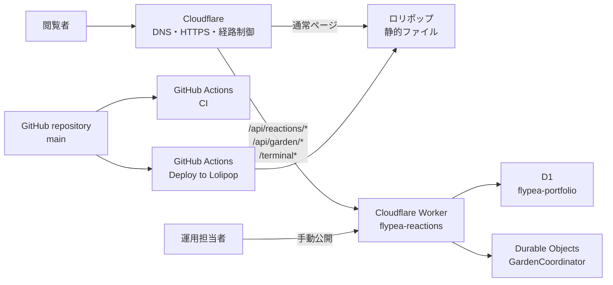

# flypea.tech 保守・運用マニュアル

この文書は、このサイトを初めて見る人が、安全に更新・公開・復旧できるようにするための入口です。
細かな技術仕様を最初から全部読む必要はありません。「やりたいこと」から該当手順へ進んでください。

- 対象: コンテンツ担当者、開発担当者、インフラ担当者、引き継ぎを受ける人
- 対象サイト: `https://flypea.tech`
- 最終確認日: 2026-07-26
- 基準: このリポジトリの `main` ブランチ、`package.json`、各サービスの本番設定

コードとこの文書が食い違う場合は、作業を止めて差異を確認します。コードだけを直して終わりにせず、
同じ変更でこのマニュアルも更新してください。

## 最初に覚える5つのルール

1. パスワード、トークン、秘密鍵、復旧コードをGitへ保存しない。
2. 作業前に `git status`、公開前に `npm run verify` を実行する。
3. 新しいコンテンツは `draft: true` で作り、確認後にだけ `draft: false` にする。
4. URLを変えるときは、同じ変更で旧URLから新URLへのリダイレクトを用意する。
5. D1 migration、Worker公開、秘密情報の変更は、影響と戻し方を確認してから行う。

分からないエラーが出た場合、推測で本番設定を変えないでください。エラーメッセージ、実行したコマンド、
変更したファイル、発生時刻を記録して、変更前の状態へ戻せるようにします。

日常作業は、初心者向けの対話メニューから開始できます。

```sh
npm run manage
```

詳しい使い方は[サイト運用CLIガイド](cli-guide.md)を参照してください。

## やりたいことから探す

| やりたいこと | 難易度 | 主に触る場所 | 手順 |
| --- | --- | --- | --- |
| Project、Note、Shelfを追加・編集する | 日常運用 | `src/content/` | [コンテンツを更新する](#コンテンツを更新する) |
| トップのCurrent Signalを変える | 日常運用 | `src/data/signals.ts` | [短い固定情報を更新する](#短い固定情報を更新する) |
| Aboutや外部リンクを変える | 日常運用 | `src/data/about.json` | [短い固定情報を更新する](#短い固定情報を更新する) |
| 分類を追加・改名する | 要注意 | `src/data/taxonomy.json` | [分類を変更する](#分類を変更する) |
| 画像、見た目、ナビゲーションを変える | 開発作業 | `public/`、`src/components/`、`src/styles/` | [画面や画像を変更する](#画面や画像を変更する) |
| ページやURLを追加・変更する | 開発作業 | `src/pages/`、`astro.config.mjs` | [URLを変更する](#urlを変更する) |
| 通常のサイト更新を公開する | 日常運用 | GitHub Actions | [静的サイトを公開する](#静的サイトを公開する) |
| リアクションAPIを変更する | インフラ作業 | `worker/`、Cloudflare | [Workerを公開する](#workerを公開する) |
| GARDEN / 000を変更する | インフラ作業 | `worker/`、Garden関連ファイル | [GARDENを公開する](#gardenを公開する) |
| ホスティング、ドメイン、Cloudflareなどの基盤を変更する | 基盤変更 | 複数サービス | [基盤変更・サービス移行マニュアル](platform-change-manual.md) |
| 公開後に問題が起きた | 緊急対応 | GitHub、Cloudflare、ロリポップ | [障害時の初動](#障害時の初動) |
| 次の担当者へ引き継ぐ | 管理作業 | 非公開の管理台帳 | [引き継ぎ](#引き継ぎ) |

「日常運用」はコード経験が少なくても手順どおりに進められる範囲です。「開発作業」はHTML、CSS、
Astroの確認が必要です。「インフラ作業」は本番データやAPIへ影響するため、Cloudflareの権限と
復旧判断ができる人が担当します。

## サイトの全体像



重要な境界は次のとおりです。

- 通常ページはAstroが生成する静的ファイルです。`dist/` の中身をロリポップから配信します。
- `/api/reactions/*`、`/api/garden/*`、`/terminal*` がCloudflare Workerへ進みます。
- JavaScriptが無効なページは `/terminal/` へ案内され、WorkerがリクエストのUser-Agentと応答時刻（JST）を表示します。Workerはこれらをアプリデータとして保存しません。
- 記事本文はAPIから独立しています。Workerが止まっても、通常ページは読めます。
- `main` への反映で自動公開されるのはロリポップ側の静的サイトです。
- Worker、D1 migration、Cloudflare Bulk Redirectsは自動公開されません。必要な場合は手動作業です。
- GARDENの永続データはD1、操作の直列化はDurable Objectsが担当します。

より詳しい構成は[フロントエンド構成](frontend-foundation.md)、
[Cloudflare Worker / D1](cloudflare-reactions.md)、
[GARDEN / 000](garden-000.md)を参照してください。ホスティング、ドメイン、Cloudflare、D1など
基盤自体を変更する場合は[基盤変更・サービス移行マニュアル](platform-change-manual.md)を使います。

## どの情報がどこにあるか

| 情報 | 正本 |
| --- | --- |
| Project | `src/content/projects/*.md` |
| Note | `src/content/notes/*.md` |
| Shelf | `src/content/shelf/*.md` |
| Topic、Technology、Status、Shelf kind | `src/data/taxonomy.json` |
| Current Signal | `src/data/signals.ts` |
| Aboutの興味・外部リンク | `src/data/about.json` |
| サイト名、説明、URL、GitHub URL | `src/config/site.ts` |
| 公開ページとURL | `src/pages/` |
| 共通部品 | `src/components/` |
| 共通レイアウトとメタ情報 | `src/layouts/` |
| 色、文字、余白、共通CSS | `src/styles/global.css` |
| アイコン、OGP、プロフィール画像 | `public/` |
| 静的URLリダイレクト | `astro.config.mjs` |
| Cloudflare Bulk Redirectsの編集元 | `cloudflare/redirects.json` |
| Workerと本番binding | `worker/` |
| CIと静的サイト公開 | `.github/workflows/` |
| ロリポップのキャッシュ指定 | `public/.htaccess` |

生成物の `dist/`、`.astro/`、`.wrangler/`、`cloudflare/redirects.csv` を直接編集しません。
`cloudflare/redirects.csv` は `cloudflare/redirects.json` から再生成します。

## 必要な権限と保管場所

作業前に、非公開で管理している
[引き継ぎ台帳テンプレート](operations-record-template.md)の内容を確認します。

最低限必要なサービスは次のとおりです。

| サービス | 用途 | 必要な権限 |
| --- | --- | --- |
| GitHub | コード、CI、静的サイト公開 | Repositoryのread/write、Actions閲覧 |
| Cloudflare | DNS、HTTPS、Worker、D1、Durable Objects、Redirects | 対象zoneとWorkers/D1の管理 |
| ロリポップ | 静的ファイル、SFTP、契約 | サーバーと契約の管理 |
| ドメイン管理事業者 | `flypea.tech` の更新 | ドメイン更新とDNS委任の確認 |
| パスワードマネージャー | 認証情報と復旧手段 | 指定vaultへのアクセス |

リポジトリへ保存してよいのは、サービス名、公開リソース名、設定手順までです。次は保存しません。

- パスワード、API token、Cookie secret、Admin token
- SFTP接続情報の実値
- 2要素認証の復旧コード
- GARDENのプレイヤー復旧コード
- 個人のメールアドレス、電話番号、請求情報
- D1の本番バックアップ

## 初回セットアップ

### 1. 作業環境を用意する

Node.js 24、npm 11以上、Gitを用意します。Node.jsのバージョンは `.nvmrc` が正本です。
Node Version Managerを使う場合は次の順です。

```sh
nvm install
nvm use
npm ci
```

`npm ci` は `package-lock.json` に固定された依存関係を入れます。依存関係を意図的に更新する場合以外、
`package-lock.json` を不用意に変えません。

### 2. 現在の状態を検証する

```sh
npm run manage -- doctor
npm run manage -- verify
```

完了まで待ち、終了コードが成功であることを確認します。警告やエラーが出た状態から新しい作業を
始めると、元からあった問題と自分の変更を区別できません。

### 3. ローカル表示を確認する

```sh
npm run manage -- preview start
npm run manage -- preview status
```

ブラウザで `http://127.0.0.1:4321` を開きます。ログ確認と停止は次のコマンドです。

```sh
npm run manage -- preview logs
npm run manage -- preview stop
```

### 4. APIもローカルで確認する場合

この手順はリアクションまたはGARDENを変更するときだけ必要です。

1. `worker/.dev.vars.example` を `worker/.dev.vars` としてコピーする。
2. 本番とは別のローカル用 `COOKIE_SECRET` と `ADMIN_TOKEN` を設定する。
3. `worker/.dev.vars` がGitの対象外であることを `git status` で確認する。
4. ローカルD1 migrationを適用する。
5. WorkerとAstroを別々に起動する。

```sh
npm run worker:migrate:local
npm run worker:dev
astro dev --background
```

Astroはローカルの `/api/reactions` と `/api/garden` を `http://localhost:8787` へ転送します。

## 通常の変更フロー

### 1. 作業前

```sh
git status
```

変更が残っている場合は、それが自分の作業か、別の担当者の作業かを確認します。内容を確認せずに
削除、上書き、`git reset --hard` を実行しません。

作業ツリーが空であることを確認できたら、最新状態へ更新して作業ブランチを作ります。

```sh
git pull --ff-only
git switch -c docs-or-content/short-description
```

### 2. 変更する

この文書の目的別手順に従います。一度に無関係な変更を混ぜないでください。

### 3. ローカルで見る

```sh
astro dev --background
```

変更したページだけでなく、ホーム、一覧、スマートフォン幅、キーボード操作も確認します。

### 4. 自動検証する

```sh
npm run manage -- release
```

失敗したまま公開しません。原因の見方は[検証が失敗したとき](#検証が失敗したとき)を参照してください。

### 5. 差分を確認してPull Requestにする

```sh
git status
git diff
git add <今回変更したファイル>
git diff --staged
git commit -m "docs: describe the change"
git push -u origin <作業ブランチ名>
```

GitHubでPull Requestを作成し、テンプレートのチェック項目を埋めます。`CI / verify` が成功し、
公開対象と戻し方を説明できる状態で `main` へマージします。

### 6. 公開後を確認する

[公開チェックリスト](release-checklist.md)に従い、GitHub Actionsと本番URLを確認します。
ローカルで成功したことだけを公開完了の根拠にしません。

## コンテンツを更新する

詳しい項目定義は[コンテンツ編集ガイド](editing-content.md)が正本です。

### 一覧を見る

```sh
npm run content -- list
npm run content -- list project
npm run content -- list note
npm run content -- list shelf
```

### 新しく作る

```sh
npm run content:new
```

画面の質問へ順番に答えるとMarkdownが作成されます。新規ファイルは必ず `draft: true` です。

1. 作成されたファイルの `---` で囲まれたFrontmatterを確認する。
2. コメントの下へ本文を書く。
3. `npm run content:audit` を実行する。
4. ローカル表示を確認する。
5. 公開するときだけ `draft: false` にする。
6. `npm run verify` を実行する。

`draft: true` のコンテンツは公開一覧と詳細ページに出ません。

### 既存項目を編集する

```sh
npm run content -- edit note domain-and-deploy
```

`project`、`note`、`shelf` とslugを指定します。Noteの `reactionId` はリアクション数と結びつく
永続IDです。タイトルやURLを変えても変更しません。

### 削除する

削除は公開URLと検索結果へ影響します。まず `draft: true` にして非公開状態を確認し、削除が本当に
必要か判断します。公開済みの項目を削除する場合は、移動先を決めてリダイレクトも追加します。

```sh
npm run content -- delete note example-note
```

この公開処理はサーバー上の古いファイルを自動削除しません。削除やslug変更後に古いHTMLが残る場合は、
リダイレクトを先に有効にし、ロリポップの公開先を再確認してから対象ファイルだけを削除します。
公開先ディレクトリ全体を一括削除しません。

### 公開内容の基準

- ProjectとNoteには少なくとも1つTopicを付ける。
- Projectには可能な限りTechnologyを付ける。
- 概要は一覧だけで内容が分かる1〜2文にする。
- 仮文、`TODO`、`TBD` を公開しない。
- 画像には内容を説明する代替テキストを付ける。
- 居住地、年齢、学校、学年、住所、生年月日など、本人特定につながる情報を追加しない。

## 短い固定情報を更新する

### Current Signal

`src/data/signals.ts` の各 `value` を編集します。表示しない項目は `null` のままにします。
引用符、カンマ、角括弧を消さず、値の文字列だけを変更します。

### Aboutと外部リンク

`src/data/about.json` の `interests` または `links` を編集します。

- JSONでは最後の項目の後ろへ不要なカンマを付けない。
- 外部リンクは `https://` から始まる完全なURLにする。
- リンク先、ラベル、説明が一致していることをブラウザで確認する。
- 個人情報を追加しない。

### サイト共通情報

サイト名、説明、URL、作者、GitHub URLは `src/config/site.ts` にあります。ドメインを変更する場合は
Cloudflare、ロリポップ、Workerの `SITE_ORIGIN`、canonical URL、GitHub Secrets、リダイレクトまで
影響するため、単独の文字修正として扱いません。

## 分類を変更する

Topic、Technology、Status、Shelf kindは複数ページから参照されます。手編集より統合CLIを優先します。

```sh
npm run content -- taxonomy list topic
npm run content -- taxonomy add topic new-id
npm run content -- taxonomy edit topic new-id
npm run content -- taxonomy rename topic old-id new-id
```

使用中の分類を削除する場合は置換先が必要です。

```sh
npm run content -- taxonomy delete topic old-id --replace-with new-id
```

変更後は必ず次を実行します。

```sh
npm run content:audit
npm run verify
```

分類IDはURLにも使われます。IDを改名・削除した場合は、旧分類URLから新しいURLへのリダイレクトも
検討します。

## 画面や画像を変更する

| 変更 | 場所 | 注意 |
| --- | --- | --- |
| ナビゲーション | `src/components/SiteHeader.astro` | 現在地表示、狭い画面、キーボード操作を確認 |
| フッター | `src/components/SiteFooter.astro` | 外部URLと表示年を確認 |
| ページ構成 | `src/pages/` | URL、title、description、canonicalを確認 |
| 共通レイアウト | `src/layouts/` | 全ページのheadとナビゲーションへ影響 |
| 色・文字・余白 | `src/styles/global.css` | 明暗差、focus表示、スマートフォン幅を確認 |
| プロフィール画像 | `public/images/profile.webp` | 同じ用途・形式を維持 |
| OGP画像 | `public/og.png` | 1200 × 630pxを維持 |
| favicon | `public/favicon*`、`public/apple-touch-icon.png` | 各形式と大きさを維持 |

Astroでは `src/pages/` のファイル配置がURLになり、`.astro` ファイルはHTML、CSS、JavaScriptを
まとめられるコンポーネントです。初めて構造を変える場合は、末尾の
[公式リファレンス](#公式リファレンス)を先に確認します。

見た目の変更後は、最低でも次を確認します。

- 320px程度の狭い画面とデスクトップ
- キーボードのTab移動とfocus表示
- 画像の代替テキスト
- ホーム、Index、Projects、Notes、Shelf、About
- JavaScriptを使うフィルターとリアクション
- `npm run verify`

## URLを変更する

URL変更はリンク切れ、検索結果、リアクションID、サーバー上の古いファイルへ影響します。

1. 新しいURLを決める。
2. Noteの場合、`reactionId` は変更しない。
3. ページまたはMarkdownファイルを移動する。
4. `cloudflare/redirects.json` へ旧URLと新URLを追加する。
5. Astroの固定ルート変更なら `astro.config.mjs` の `redirects` も更新する。
6. CSVを生成する。
7. 検証する。
8. 静的サイトを公開する。
9. Cloudflare DashboardへCSVを反映し、Bulk Redirect Ruleが有効であることを確認する。
10. 旧URLが301で新URLへ進むこと、新URLが200で表示されることを確認する。

```sh
npm run redirects:build
npm run verify
```

`cloudflare/redirects.csv` は生成物ですが、Cloudflareへ投入する内容をレビューできるよう
リポジトリでも同期を保ちます。詳細は
[URL変更とリダイレクト](cloudflare-reactions.md#url変更とリダイレクト)を参照してください。

## 静的サイトを公開する

通常のコンテンツ、画像、Astro、CSSの変更はこの経路です。

1. Pull Requestの `CI / verify` が成功していることを確認する。
2. `main` へマージする。
3. GitHubの `Actions > Deploy to Lolipop` を開く。
4. `LOLIPOP_DEPLOY_ENABLED=true` なら、`main` へのpushで自動実行される。
5. 自動公開が無効なら `Run workflow` から手動実行する。
6. `Upload dist to Lolipop` まで成功したことを確認する。
7. [公開チェックリスト](release-checklist.md)で本番を確認する。

GitHub Actionsの設定と必要なSecretsは[ロリポップへのデプロイ](deployment.md)が正本です。

注意: 現在のSFTP公開は新しいファイルを送りますが、サーバー上の不要ファイルを自動削除しません。
削除やslug変更を含む公開では、旧URLのリダイレクトと古いファイルの扱いを必ず確認します。

## Workerを公開する

対象はリアクションAPI、GARDEN API、テキスト表示ページ、Worker設定です。`main` へのマージだけではWorkerは更新されません。

### コードまたは設定だけを変える

```sh
npm run worker:check
npm run worker:test
npx wrangler deploy --config worker/wrangler.jsonc
```

公開後は最低限、次の読み取りを確認します。

```sh
curl "https://flypea.tech/api/reactions/batch?ids=domain-and-deploy"
curl "https://flypea.tech/api/garden/leaderboard?limit=1"
```

書き込みAPIは本番データを変えるため、テスト用IDや確認後の削除方針がない状態で試しません。

### D1 migrationを伴う

1. migrationの内容と、旧Workerとの互換性をレビューする。
2. D1を暗号化された保管先へバックアップする。
3. `npm run worker:check` と `npm run worker:test` を成功させる。
4. remote migrationを適用する。
5. 直後に対応するWorkerを公開する。
6. 読み取り、書き込み、管理画面を確認する。
7. 必要なら最後に静的サイトを公開する。

```sh
npm run worker:migrate:remote
npx wrangler deploy --config worker/wrangler.jsonc
```

D1バックアップの例です。出力ファイルはリポジトリ外へ置き、作業後すぐ暗号化された保管先へ移します。

```sh
npx wrangler d1 export flypea-portfolio --remote --config worker/wrangler.jsonc --output /tmp/flypea-portfolio-backup.sql
```

WorkerのロールバックはD1やDurable Objectsのデータを元に戻しません。schema変更を含む場合、
古いWorkerが現在のデータ構造で動くか確認できない限りロールバックしません。

## GARDENを公開する

GARDENは公開順が重要です。必ず[GARDEN / 000 運用ガイド](garden-000.md#本番反映順)に従います。

1. D1 migration
2. WorkerとDurable Object
3. Garden APIの確認
4. Astro静的サイト

`GardenCoordinator` のstorage backendは後から切り替えられません。Durable Objectのmigration設定を
理解せずに `worker/wrangler.jsonc` を変更しません。

管理画面:

- リアクション集計: `https://flypea.tech/admin/reactions/`
- GARDENランキング管理: `https://flypea.tech/admin/garden/`

どちらも `ADMIN_TOKEN` を使います。トークンをURL、スクリーンショット、Issue、チャットへ貼りません。

## 秘密情報を変更する

Worker secretsはCloudflareへ保存し、Gitには保存しません。

```sh
npx wrangler secret put ADMIN_TOKEN --config worker/wrangler.jsonc
npx wrangler secret put COOKIE_SECRET --config worker/wrangler.jsonc
```

影響は同じではありません。

- `ADMIN_TOKEN`: 管理画面の認証だけに影響する。変更後は旧トークンが使えないことを確認する。
- `COOKIE_SECRET`: リアクションCookie、GARDENのセッション、GARDEN復旧コードの検証へ影響する。
  通常の定期作業として安易に変更しない。漏えい時は影響を記録したうえで緊急変更する。
- ロリポップSFTP情報: GitHub Actions Secretsを更新し、手動Deployで接続を確認する。

秘密情報を変更したら、非公開の引き継ぎ台帳へ変更日、変更者、理由、影響、確認結果を記録します。
値そのものは記録欄へ貼りません。

## 定期保守

### 公開のたび

- [公開チェックリスト](release-checklist.md)を完了する。
- GitHub Actionsの失敗を放置しない。
- 変更したURLと主要導線を本番で確認する。
- API変更時はCloudflareのエラーと応答を確認する。

### 毎月

- GitHub Actionsの直近実行に継続的な失敗がないか確認する。
- Cloudflare Workersのエラー、D1使用量、予期しない急増を確認する。
- ロリポップの容量、契約、障害情報を確認する。
- 主要外部リンクと旧URLのリダイレクトを抜き取り確認する。
- `npm outdated` で更新候補を確認する。結果を見ただけで一括更新せず、更新は別Pull Requestにする。
- D1バックアップと復元手順の保管場所を確認する。

### 3か月ごと

- GitHub、Cloudflare、ロリポップ、ドメイン管理の担当者と予備担当者を確認する。
- 2要素認証と復旧手段が利用できるか、値を露出せず確認する。
- 不要になったメンバーやtokenの権限を削除する。
- このマニュアルと引き継ぎ台帳の最終確認日を更新する。
- ローカルを作り直し、`npm ci` と `npm run verify` が通ることを確認する。

### 更新期限の前

- ドメイン、ロリポップ、Cloudflareの契約と支払い手段を確認する。
- 自動更新だけに依存せず、期限と予備連絡先を非公開台帳へ記録する。

## 検証が失敗したとき

最初に、出力の一番下だけでなく「最初に失敗したコマンド」と、その直前のエラーを読みます。

| 失敗箇所 | よくある原因 | 最初の対応 |
| --- | --- | --- |
| `npm ci` | Node.js不一致、lockfile不整合 | `node --version` と `.nvmrc` を確認 |
| `npm run check` | Astro/TypeScriptの型エラー | 最初に表示されたファイルと行を直す |
| `npm run lint` | 書式、危険なコード | 指摘箇所だけを直し、差分を再確認 |
| `npm run content:audit` | 必須項目、taxonomy、URL、画像 | エラー内のファイルと項目を確認 |
| `npm run redirects:check` | JSONとCSVが不一致 | `npm run redirects:build` 後に差分確認 |
| `npm run worker:check` | Worker型、binding、設定 | `worker/` と `worker/wrangler.jsonc` を確認 |
| `npm run worker:test` | API仕様やDB処理の変更 | 失敗したテスト名と期待値を確認 |
| `npm run build` | route、content schema、asset | 最初のAstroエラーを確認 |
| `npm run site:check` | 必須ページ、canonical、OGP、redirect | 意図したURL変更ならvalidatorも更新 |
| GitHubのDeploy | Secret不足、host key、SFTP、公開先 | 失敗したstepと[デプロイ手順](deployment.md)を確認 |

`npm run format` は複数ファイルを書き換える可能性があります。実行後は必ず `git diff` で、
今回の目的と無関係な変更が混じっていないか確認します。

## 障害時の初動

### 共通の5手順

1. **止める**: 原因が不明な追加公開、migration、秘密情報変更を止める。
2. **範囲を分ける**: 通常ページ、リアクション、GARDEN、管理画面のどこが壊れているか確認する。
3. **記録する**: 発生時刻、URL、HTTP status、画面、直前の公開、Actions run、Worker deploymentを記録する。
4. **安全な状態へ戻す**: 静的サイトとWorkerを別々に戻す。D1は自動では戻らない。
5. **確認して共有する**: 主要URLとデータ整合性を確認し、原因と再発防止を記録する。

### 症状別の切り分け

| 症状 | 確認順 |
| --- | --- |
| サイト全体が開かない | Cloudflare障害・DNS → ロリポップ障害 → 直近Deploy |
| 変更が反映されない | Deploy成功 → 対象commit → ブラウザcache → ロリポップ上の更新時刻 |
| 一部URLが404 | `src/pages/` / content slug → `dist/` → redirect → 古いファイル |
| 本文は読めるがリアクションだけ動かない | `/api/reactions/batch` → Worker deployment → D1 → browser console |
| GARDENだけ動かない | `/api/garden/leaderboard` → Worker → D1 migration → Durable Object binding |
| 管理画面が401 | 入力token → `ADMIN_TOKEN` の更新履歴 → 対象Worker |
| 書き込みが403 | 本番origin → `SITE_ORIGIN` → Cloudflare Route |
| Deployが失敗 | GitHub Actionsの最初の失敗step → Secret → SFTP host key → 容量 |
| 削除したページが残る | 現行Deployは削除同期しない → redirect → 対象ファイルだけ手動確認 |

### 静的サイトを戻す

誤った公開commitを直接消さず、GitHub上でRevert Pull Requestを作るか、作業ブランチでrevertします。

```sh
git switch -c rollback/short-description
git revert <問題のcommit>
git push -u origin rollback/short-description
```

CI成功後に `main` へマージし、Deploy完了を確認します。公開方式は古いファイルを削除しないため、
問題のcommitで新しいURLを追加した場合は、そのURLがサーバーに残っていないか別途確認します。

### Workerを戻す

Cloudflare Dashboardの `Workers & Pages > flypea-reactions > Deployments` で、動作していたversionを
選んでRollbackします。CLIを使う場合は `wrangler rollback` です。

注意:

- Worker rollbackはD1とDurable Objectsの状態を戻さない。
- binding、Durable Object migration、D1 schemaが変わった場合、古いversionへ戻せない、または
  古いコードが現在のデータで動かないことがある。
- rollback後はリアクションとGARDENを別々に確認する。

### D1のデータに問題がある

追加の書き込みを止められる範囲で止め、直前のmigration、バックアップ、CloudflareのTime Travelが
利用できるかを確認します。バックアップSQLを本番へそのまま投入すると現在データを重複・上書きする
可能性があります。影響するtableと復元時点を特定できる人だけが復元を行います。

### 秘密情報が漏れた

1. 漏れた値の種類と公開範囲を特定する。
2. 対応サービスで値を無効化または変更する。
3. Git履歴、Issue、Actions log、チャットなど露出箇所を確認する。
4. 変更後の接続と認証を確認する。
5. 影響と再発防止を非公開の事故記録へ残す。

`COOKIE_SECRET` の変更はGARDENの既存セッションと復旧コードにも影響します。漏えい対応では必要でも、
影響を「管理画面のtoken変更」と同じに扱いません。

## 引き継ぎ

引き継ぎは「アカウントを渡す」だけでは完了しません。
[引き継ぎ台帳テンプレート](operations-record-template.md)を非公開領域へコピーし、次を一緒に確認します。

1. 新担当者が自分のアカウントで各サービスへ入れる。
2. 新しいPCで `npm ci` と `npm run verify` が成功する。
3. draftのNoteを1件作り、ローカル表示できる。
4. GitHub ActionsのCIとDeploy履歴を読める。
5. CloudflareでWorker、D1、Routes、Deploymentsを見つけられる。
6. ロリポップの公開先を確認できる。
7. 静的サイトとWorkerの戻し方を説明できる。
8. ドメインと契約の更新期限、予備担当者、復旧手段を確認できる。
9. 秘密値を画面共有、チャット、リポジトリへ残していない。

最後に、旧担当者の不要な権限とtokenを削除し、引き継ぎ日と確認者を記録します。

## このマニュアルを更新する条件

次の変更では、同じPull Requestでこの文書またはリンク先文書を更新します。

- `package.json` のコマンド、Node.jsバージョン、初回セットアップ
- content schema、taxonomy、公開条件
- ページURL、ナビゲーション、リダイレクト
- GitHub Actions、Secrets、Variables、公開先
- Cloudflare Routes、Worker binding、D1、Durable Objects、migration
- 管理画面、認証、秘密情報の種類
- バックアップ、ロールバック、障害対応
- サービス契約、担当者、更新期限の管理方法
- ホスティング、ドメイン、DNS、Cloudflare、D1、CI/CDなどの基盤変更

Pull Requestテンプレートの「マニュアル影響」を毎回確認し、「影響なし」の場合も理由を一言残します。

## 用語

| 用語 | 意味 |
| --- | --- |
| Astro | Markdownや`.astro`から静的HTMLを作る仕組み |
| build | 公開用ファイルを `dist/` に生成する処理 |
| draft | 公開前の下書き。`true` は非公開、`false` は公開対象 |
| Frontmatter | Markdown先頭の `---` で囲まれたタイトルや日付などの設定 |
| slug | URLに使う半角英数字とハイフンの識別名 |
| taxonomy | Topic、Technology、Statusなど共通の分類 |
| CI | 公開前に型、内容、テスト、buildを自動確認する仕組み |
| deploy | 検証済みの変更を本番へ反映すること |
| Worker | Cloudflare上で動くリアクション・GARDENのAPI |
| D1 | リアクションとGARDENの永続データを持つデータベース |
| Durable Object | 同じGARDENへの操作を直列化するCloudflareの仕組み |
| migration | データベース構造を段階的に変更するSQL |
| redirect | 古いURLから新しいURLへ転送する設定 |
| rollback | 問題のある公開を以前の動作版へ戻すこと |
| canonical | 検索エンジンへ示すページの正規URL |
| OGP | SNSでURLを共有したときに使われるタイトルや画像 |

## 公式リファレンス

実装方法が変わる可能性があるため、構造変更の前に公式情報を確認します。

- [Astro Routing](https://docs.astro.build/en/guides/routing/)
- [Astro Components](https://docs.astro.build/en/basics/astro-components/)
- [Astro Content Collections](https://docs.astro.build/en/guides/content-collections/)
- [Astro Styles and CSS](https://docs.astro.build/en/guides/styling/)
- [GitHub Actions: Re-running workflows and jobs](https://docs.github.com/en/actions/how-tos/manage-workflow-runs/re-run-workflows-and-jobs)
- [Cloudflare Workers: Rollbacks](https://developers.cloudflare.com/workers/versions-and-deployments/rollbacks/)
- [Cloudflare D1: Import and export data](https://developers.cloudflare.com/d1/best-practices/import-export-data/)
